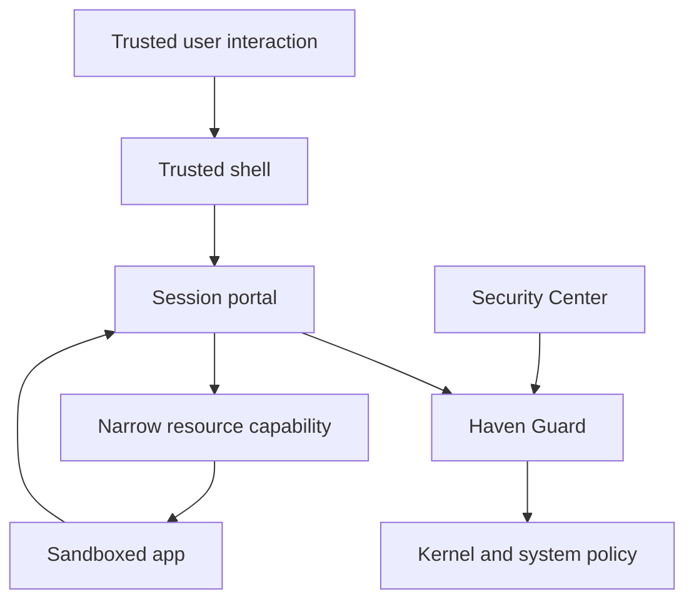

# Architecture
Status: design proposal.

## Boundaries
Untrusted applications run in restricted sandboxes. The trusted shell/compositor owns genuine user interaction and security indicators. User-session brokers mediate resources. Haven Guard is a minimal system policy service. Vault mediates secret operations. The unprivileged Security Center reads state and submits typed policy requests.

## Interface constraints
Use authenticated local IPC, peer credentials, explicit application identity, bounded messages, versioned schemas, request IDs, and deny-by-default authorization. D-Bus versus Unix sockets remains an ADR decision. No arbitrary shell-command API. UI never runs privileged firewall commands.

Separate system-wide policy from user-session grant handling. Do not place every parser, driver, or desktop function in a root daemon. Each broker has only the privileges needed for its resource.

## Planned Rust workspace
crates/policy-types, guard, portal, sandbox-launcher, vault-client, security-center-client, and demo-editor. Shared types must not turn into an implicit privileged execution framework. No workspace exists yet.

## Failure behavior
Service restart invalidates ephemeral tokens. Persist policy with schema versioning and atomic transactions. Backend apply failure must retain the previous known policy or deny the affected operation. Report degraded enforcement explicitly.

## Open decisions
Trusted gesture source; compositor changes; robust application identity; enforceable file revocation; backend rollback; cross-session behavior; authorization with YubiKey; update anti-rollback. See DECISIONS.md.
