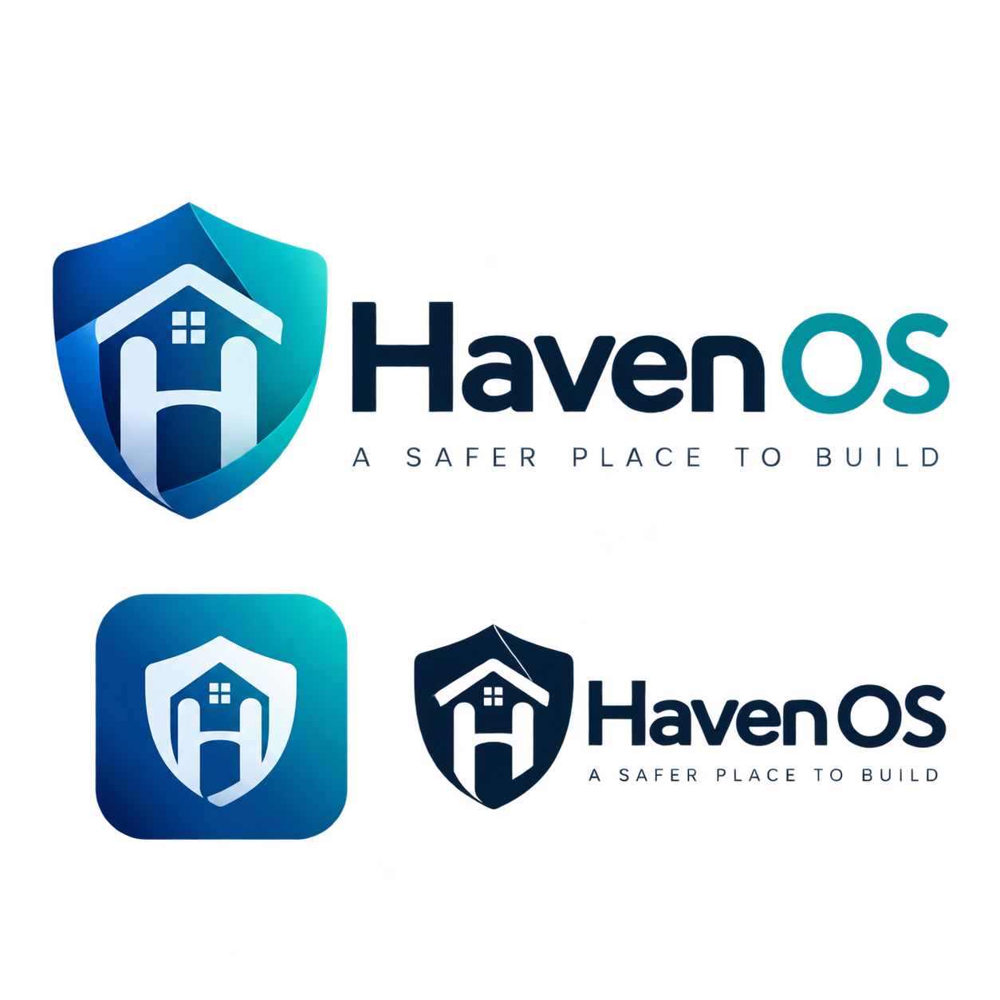

**A safer place to build.**

Haven OS is an open-source, privacy-first Debian-derived operating system project. It aims to provide a trustworthy place to think, work, and build through explicit user authority, application isolation, and visible security controls.

**Status: Phase 1 — architecture and governance.** No production distribution, installable ISO, security daemon, or verified security guarantees exist yet. Documents describe intended behavior unless explicitly marked implemented.

## Why Haven
Privacy supports concentration and creative work. Users should be able to inspect which applications can access their files, sensors, network, and secrets. Haven minimizes unnecessary observation and makes authority understandable.

## Design commitments
- Debian Stable upstream; selectively diverge where the security model requires it.
- Rust for security-critical services, with small auditable interfaces.
- Authority originates from trusted user interaction or explicit system policy.
- Sandboxed apps receive private storage and narrow grants, not static access to host folders.
- TPM2, Secure Boot, LUKS2, tested recovery, and measured-boot integration for the secure profile.
- KVM VMs as development boundaries; rootless containers inside VMs.
- Haven Guard manages policy; the unprivileged Security Center uses a narrow API.
- nftables integration, separate Internet/LAN permissions, and clear security downgrade indicators.
- No hidden telemetry. Security claims require evidence.

## Start here
| Purpose | Document |
|---|---|
| Execution and acceptance gates | [PLANS.md](PLANS.md) |
| Release milestones | [ROADMAP.md](ROADMAP.md) |
| Components and boundaries | [ARCHITECTURE.md](ARCHITECTURE.md) |
| Adversaries and limits | [THREAT-MODEL.md](THREAT-MODEL.md) |
| Authority and permissions | [TRUST-MODEL.md](TRUST-MODEL.md), [PERMISSION-MODEL.md](PERMISSION-MODEL.md) |
| Human and AI contributions | [CONTRIBUTING.md](CONTRIBUTING.md), [AGENTS.md](AGENTS.md) |
| Project identity | [branding/README.md](branding/README.md) |

## Planned components
Haven Guard (securityd), Portal, Vault, Apps sandbox, Security Center, and VM compartment manager. See each component directory for scope and open questions.

## First proof of concept
A sandboxed editor cannot list host home folders or open a trusted chooser by itself. A trusted user action grants one selected file. Tests must cover spoofed identity, token replay, path races, denial, expiration, and revocation limitations.

## Participation and access
Everyone may view, fork, and propose pull requests. Only the owner and explicitly authorized collaborators with write permission may push or merge to this repository. Being listed as a contributor does not itself confer write access. See [GOVERNANCE.md](GOVERNANCE.md).

## Licensing
Original repository code and documentation are provided under [MIT](LICENSE). Upstream components retain their own licenses; this repository does not relicense Debian. Supplied branding artwork has separate terms in [branding/README.md](branding/README.md). Name clearance remains open; no trademark registration is claimed.
